# 大理此刻 DaLiNow

> 大理全域「当日文旅活动 + 官方打卡机位 + 现场纪实」微信小程序开源实现。Node.js/Express + Python/Flask 双后端、Vue 3 管理后台、MySQL，代码与文档完整开源。
>
> 适合想搭建本地文旅活动聚合平台、或学习「小程序 + 双后端 + 管理后台」完整工程结构的团队。

## 设计初衷

大理的文旅信息长期是分散的：活动散落在各个公众号、社群和本地人的口头消息里，游客到了古城才知道「今天有绕三灵」；热门机位没人指引，出片全靠运气；活动的真实氛围只存在于到过现场的人的朋友圈，平台上能看到的永远是官方宣传图。

「大理此刻」想接上这三个断点：

- 把**当日**能参与的活动聚到一个入口，而不是让游客自己拼信息
- 把**官方认证的机位**、拍摄教程和错峰建议给到游客，而不是让人扎堆拍同一张废片
- 把**现场真实内容**沉淀成可浏览、可分享的公共氛围，而不是让热度止步于个人朋友圈

名字里的「此刻」，是与「静态攻略」划清界限：攻略告诉你大理有什么，我们告诉你**今天、现在、这里**正在发生什么。

## 设计理念

- **当下优先**：首页只展示当日有效活动，过期内容自动退场，不做「看起来很丰富」的信息堆砌
- **官方引导 + 用户共创**：官方提供标准机位、教程与人流指引，用户用现场纪实内容回填真实氛围，两者互相成就
- **内容要能被看见**：每场活动都有独立的现场广场，发布即进入活动氛围；分享海报自带小程序入口，降低传播门槛
- **轻量可落地**：V1.0 只跑通「游玩 + 传播」闭环，会员、积分、交易链路明确留给后续版本（边界见[需求说明书](./docs/requirements/miniprogram-v1.0.md)的「迭代边界」）
- **完整开源**：代码、文档、部署脚本一并开放，便于同类文旅项目参考或复用「实时活动 + 现场纪实」这套模型

## 和内容平台有什么不同

抖音和小红书帮你看「别人眼中的大理」，大理此刻帮你看「今天的大理正在发生什么，以及你现在能怎么参与」。差异不在内容好不好看，而在**组织单位**：它们是内容平台，以笔记和视频为中心；这里以「活动」为中心，内容是挂在活动与点位下面的。

| 维度 | 内容平台（抖音 / 小红书） | 大理此刻 |
|---|---|---|
| 组织单位 | 笔记、短视频等内容单元 | 活动：时间、地点、名额、费用、报名规则都是结构化字段 |
| 时效 | 由发布者决定，游客需自行判断是否为「当日」 | 默认只展示当日有效活动，过期自动退场 |
| 能否参与 | 看完通常只能私信或另找入口 | 站内完成预约报名，名额与状态可查 |
| 拍照 | 机位靠评论区追问或私藏攻略 | 官方标准机位：坐标、角度、构图、最佳时段、人流与错峰建议 |
| 现场感 | 算法推荐的热帖，可能是几个月前的 | 每场活动独立现场广场，按时间倒序的实时内容 |
| 沉淀 | 内容留在个人账号里，随账号沉浮 | 内容挂在活动与打卡点下，长期可检索复用 |

这不是要替代内容平台做「种草」，而是补齐内容平台结构上做不到的三件事：**把当日活动聚合成可检索的入口、让「看到」直接连到「约上」、把现场内容按活动归档**。分享环节仍然回到微信好友、群和朋友圈（见[需求说明书](./docs/requirements/miniprogram-v1.0.md) 3.3.4 社交裂变分享），两者是互补关系。

## 项目组成

| 子项目 | 目录 | 技术栈 | 入口 / 端口 |
|---|---|---|---|
| 服务端 | [`services/server`](./services/server) | Node.js Express + Python Flask + MySQL | `app.js` :3000（公开 API）<br>`app.py` :5000（管理后台 API） |
| 微信小程序 | [`apps/miniprogram`](./apps/miniprogram) | 原生小程序 | 微信开发者工具导入 |
| 管理后台 | [`apps/admin-panel`](./apps/admin-panel) | Vue 3 + Element Plus + ECharts | `npm run dev` :5173，构建产物挂载 `/admin/` |

## 界面预览

### 微信小程序

<table>
  <tr>
    <td align="center">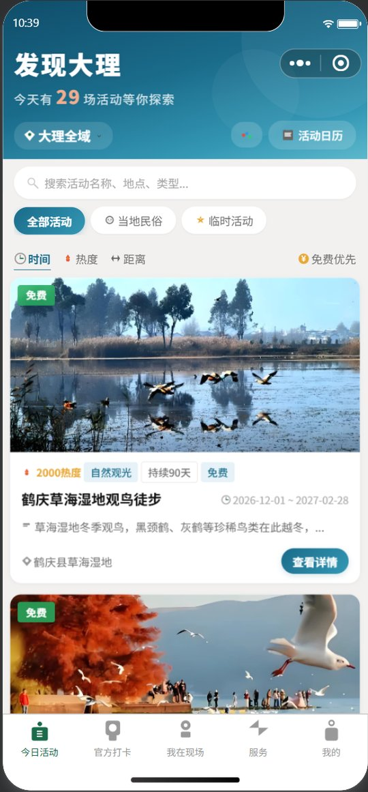<br><sub>今日活动</sub></td>
    <td align="center">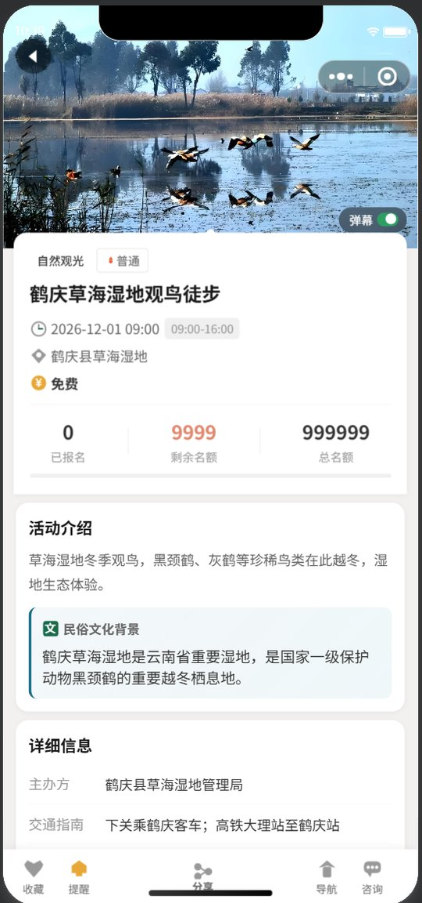<br><sub>活动详情</sub></td>
    <td align="center">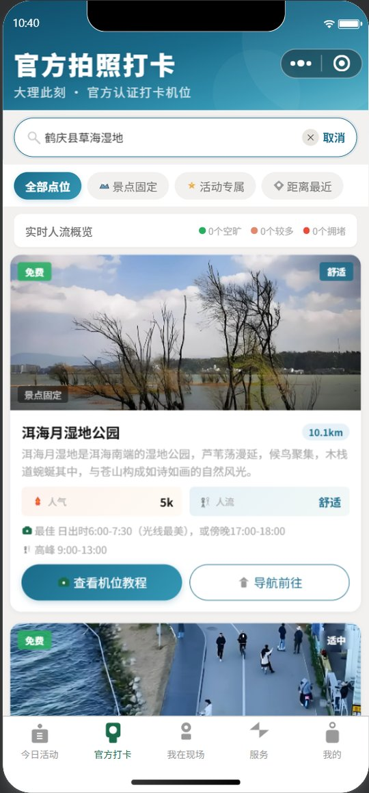<br><sub>官方打卡</sub></td>
    <td align="center">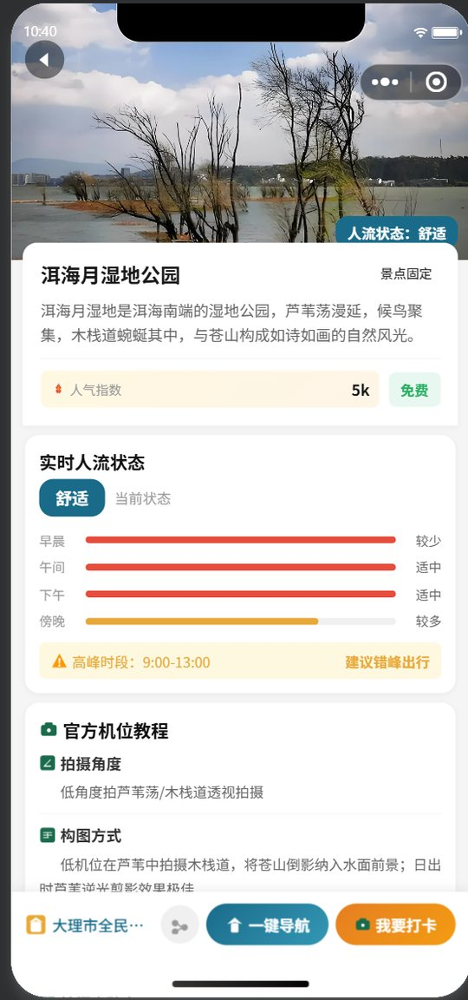<br><sub>打卡点详情</sub></td>
    <td align="center">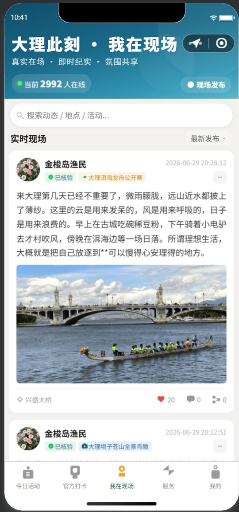<br><sub>我在现场</sub></td>
  </tr>
  <tr>
    <td align="center">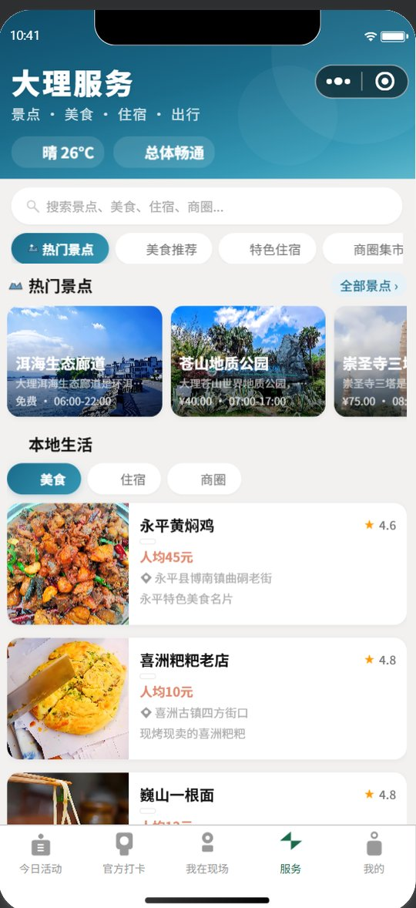<br><sub>文旅服务</sub></td>
    <td align="center">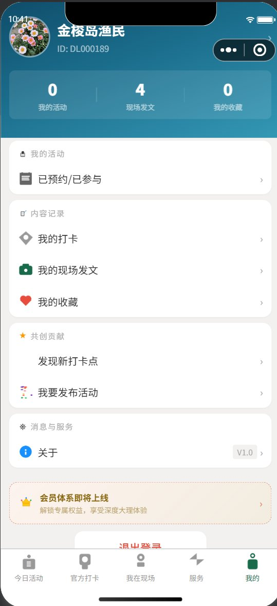<br><sub>我的</sub></td>
    <td align="center">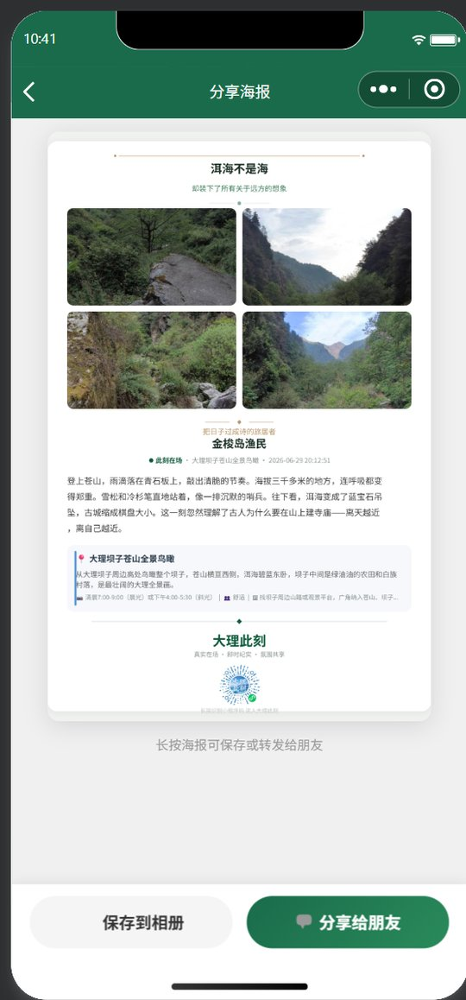<br><sub>分享海报</sub></td>
    <td align="center">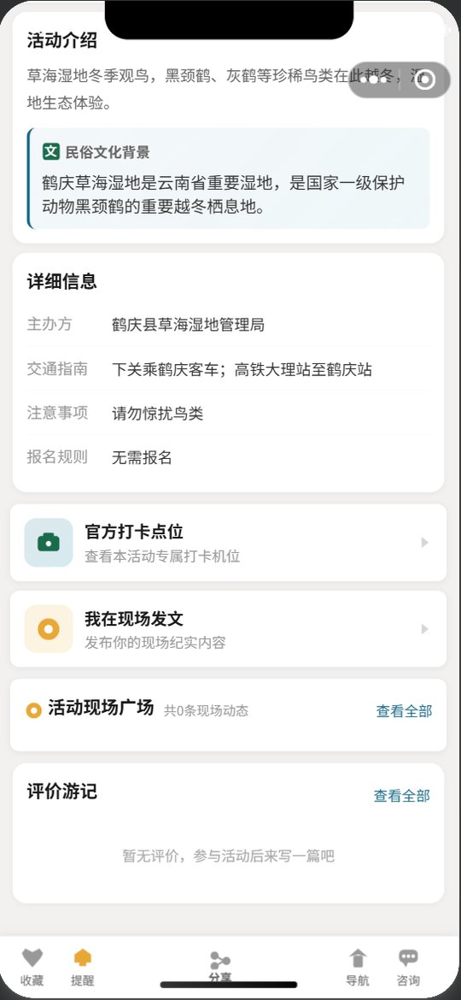<br><sub>活动图文详情</sub></td>
    <td align="center">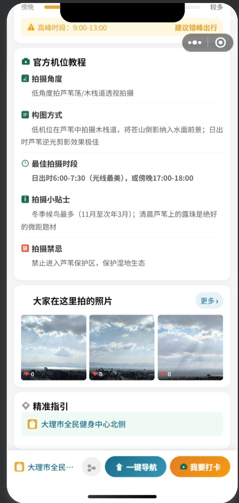<br><sub>机位教程</sub></td>
  </tr>
</table>

### 管理后台

<table>
  <tr>
    <td align="center">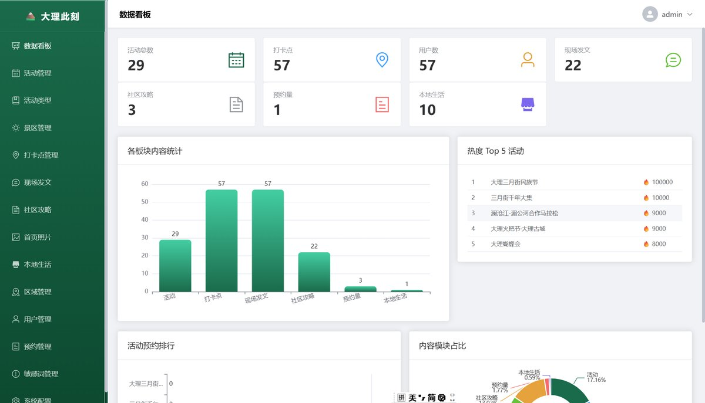<br><sub>数据看板</sub></td>
    <td align="center">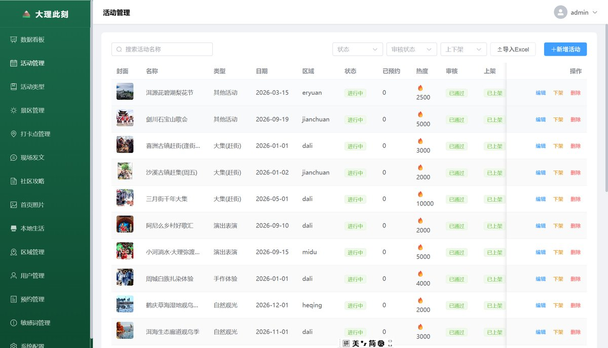<br><sub>活动管理</sub></td>
  </tr>
  <tr>
    <td align="center">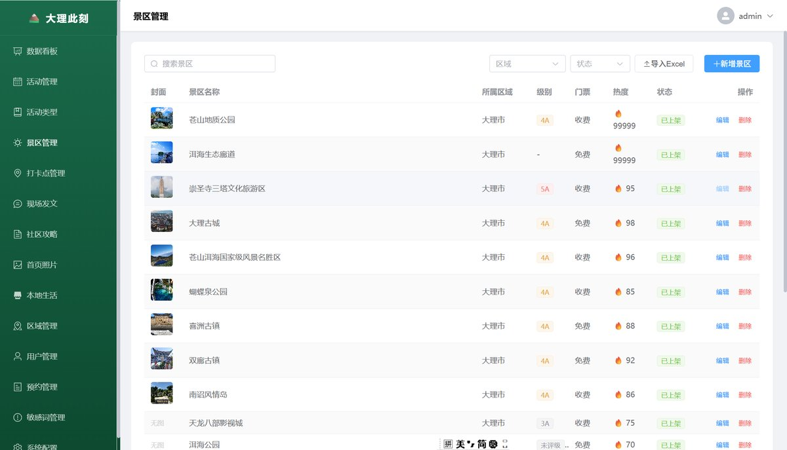<br><sub>景区管理</sub></td>
    <td align="center">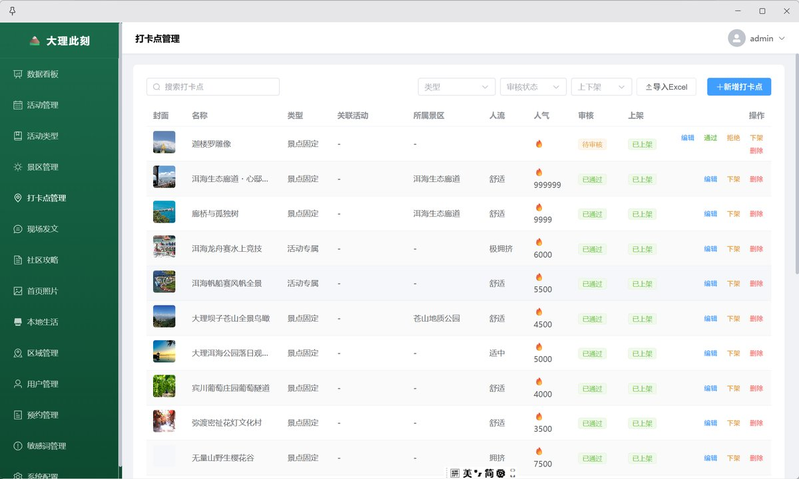<br><sub>打卡点管理</sub></td>
  </tr>
  <tr>
    <td align="center">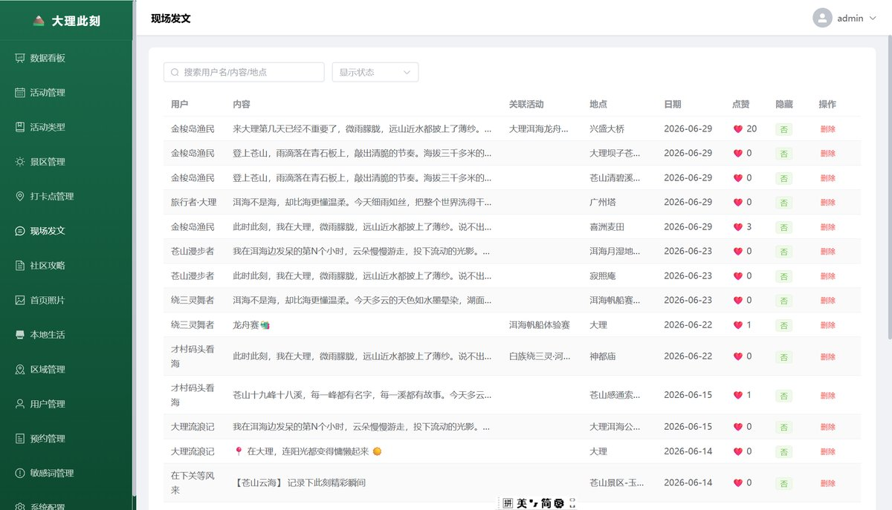<br><sub>现场发文</sub></td>
    <td align="center">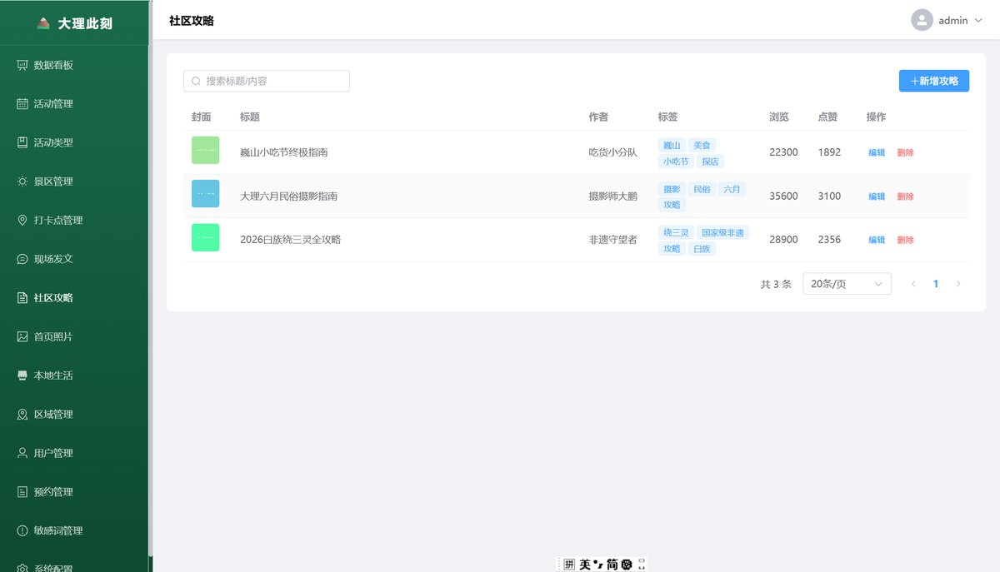<br><sub>社区攻略</sub></td>
  </tr>
  <tr>
    <td align="center">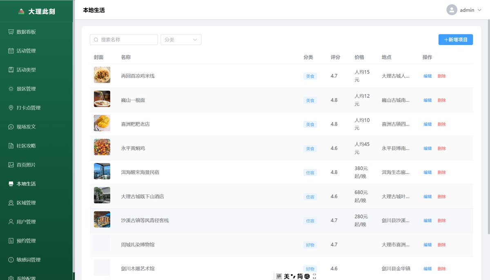<br><sub>本地生活</sub></td>
    <td></td>
  </tr>
</table>

> 截图使用 `services/server/scripts/import_seed.py` 的演示数据，不含真实用户信息。

## 系统架构

```text
微信小程序 / 管理后台
                │  HTTPS
                ▼
        Nginx (:443)
        ├── /api/            → Node.js Express (:3000)   公开 API
        ├── /api/admin/*     → Python Flask    (:5000)   管理后台 API
        ├── /admin/*         → 管理后台静态文件（apps/admin-panel 构建产物）
        └── /uploads、/images → 静态资源目录
                │
                ▼
        MySQL / MariaDB（库名 dali_now）
```

## 目录结构

```text
.
├── apps/                      # 两端前端
│   ├── miniprogram/           # 微信小程序
│   └── admin-panel/           # 管理后台（Vue 3 + Element Plus）
├── services/
│   └── server/                # 服务端
│       ├── app.js             # Node.js 公开 API 入口
│       ├── app.py             # Flask 入口
│       ├── admin_api.py       # 管理后台 API（Blueprint）
│       ├── routes/            # 公开 API 路由（13 个模块）
│       ├── middleware/        # 签名 / 登录 / 敏感词
│       ├── sql/ scripts/      # 建表、迁移、种子脚本
│       ├── images/            # 种子图片
│       └── deploy/            # Nginx、PM2、部署脚本
├── docs/                      # 项目文档（总索引见 docs/README.md）
└── .github/                   # Issue / PR 模板、CI
```

## 快速开始

```bash
# 1. 初始化数据库
cd services/server
npm install
cp .env.example .env        # 填入数据库等配置
npm run init-db

# 2. 启动服务端（两个进程）
npm start                   # Node.js API    → http://localhost:3000
pip install -r requirements.txt
python app.py               # 管理后台 API   → http://localhost:5000

# 3. 启动前端（按需）
cd apps/admin-panel && npm install && npm run dev   # http://localhost:5173
# 小程序：用微信开发者工具导入 apps/miniprogram
```

完整步骤见 [docs/getting-started.md](./docs/getting-started.md)。

## 文档

| 文档 | 说明 |
|---|---|
| [docs/README.md](./docs/README.md) | 文档总索引 |
| [docs/overview.md](./docs/overview.md) | 项目总览（业务模块与角色） |
| [docs/architecture.md](./docs/architecture.md) | 技术架构与请求链路 |
| [docs/requirements/miniprogram-v1.0.md](./docs/requirements/miniprogram-v1.0.md) | 小程序 V1.0 需求与功能设计说明书 |
| [docs/getting-started.md](./docs/getting-started.md) | 本地开发指南 |
| [docs/modules/](./docs/modules/) | 各子项目说明 |
| [docs/api.md](./docs/api.md) | API 接口概览 |
| [docs/database.md](./docs/database.md) | 数据库结构与初始化 |
| [docs/deployment/DEPLOY.md](./docs/deployment/DEPLOY.md) | 生产部署指南 |
| [docs/deployment/ssl-certificate.md](./docs/deployment/ssl-certificate.md) | SSL 证书更换手册 |
| [CHANGELOG.md](./CHANGELOG.md) | 变更日志 |
| [CONTRIBUTING.md](./CONTRIBUTING.md) | 贡献指南 |
| [SECURITY.md](./SECURITY.md) | 安全策略 |

## 安全说明

- 所有敏感信息（数据库密码、微信 AppID/Secret、管理员账号、API 签名密钥）均通过环境变量或占位符配置，**仓库不含任何真实密钥**
- `.env` 已被 `.gitignore` 忽略
- 各处配置的 `API_SECRET` 必须与服务端保持一致，否则公开 API 的签名校验会失败
- 部署后请立即修改默认账号密码，详见 [SECURITY.md](./SECURITY.md)

## 数据与素材说明

- 种子数据由 `services/server/scripts/import_seed.py` 内联定义，导入命令见 [docs/database.md](./docs/database.md)
- `services/server/images/` 下的图片仅用于本地演示，其中占位图由 `services/server/scripts/gen_placeholders.py` 生成；对外发布或商用前，请替换为自有版权素材
- `apps/miniprogram/images/` 下为小程序界面图标与模板图，可直接替换为自有设计
- `docs/assets/screenshots/` 为项目运行截图（压缩后的 JPEG），使用演示数据，可直接用于对外介绍

## 项目状态

当前版本是可运行的开源实现：Node.js 公开 API（:3000）+ Python 管理后台 API（:5000）+ 微信小程序 + 管理后台前端 + MySQL，活动浏览、预约、打卡、现场发文、社区浏览、后台内容管理等主流程可跑通。

需求文档中的部分设计能力尚未落地（如在线支付、订阅消息提醒、多角色权限、定时清理等），逐项差距见[需求实现对照](./docs/requirements/miniprogram-v1.0.md#附录-a需求实现对照截至-2026-10-23)；功能边界（明确不做的部分）见 [apps/miniprogram/README.md](./apps/miniprogram/README.md) 的「研发边界」小节。

## 常见问题

**这是什么项目？**
一个可运行的开源实现：以「当日文旅活动 + 官方打卡机位 + 现场纪实」为核心模型的微信小程序，配套 Node.js 公开 API、Python 管理后台 API 与 Vue 3 管理后台。

**和抖音、小红书是什么关系？**
互补关系。内容平台负责种草与传播，本项目负责把当日活动聚合成可检索、可预约的入口，并把现场内容按活动归档，详见[和内容平台有什么不同](#和内容平台有什么不同)。

**能直接商用吗？**
代码以 MIT 许可开源，可商用、可修改、可再分发。但种子图片与演示数据仅用于功能演示，上线前请替换为自有版权素材，并重置数据库、密钥与第三方 AK。

**需要准备哪些外部账号与资质？**
微信小程序 AppID / AppSecret（登录与发布）、已备案域名并启用 HTTPS（小程序要求）、百度地图 AK（管理后台选点，填入 `apps/admin-panel/.env` 的 `VITE_BAIDU_MAP_AK`）。若要上线付费活动，还需微信支付商户号——当前版本尚未实现支付。

**功能都实现了吗？**
活动浏览、预约、打卡、现场发文、社区浏览、后台内容管理等主流程可用；在线支付、订阅消息提醒、多角色权限、定时清理等设计项尚未落实，逐项差距见[需求实现对照](./docs/requirements/miniprogram-v1.0.md#附录-a需求实现对照截至-2026-10-23)。

**怎么改成别的城市或目的地？**
数据结构与地区无关（区县、活动、打卡点、现场动态是通用模型），替换 `services/server/scripts/import_seed.py` 的种子数据、小程序文案与图片资源即可。

## 许可证

[MIT License](./LICENSE)
